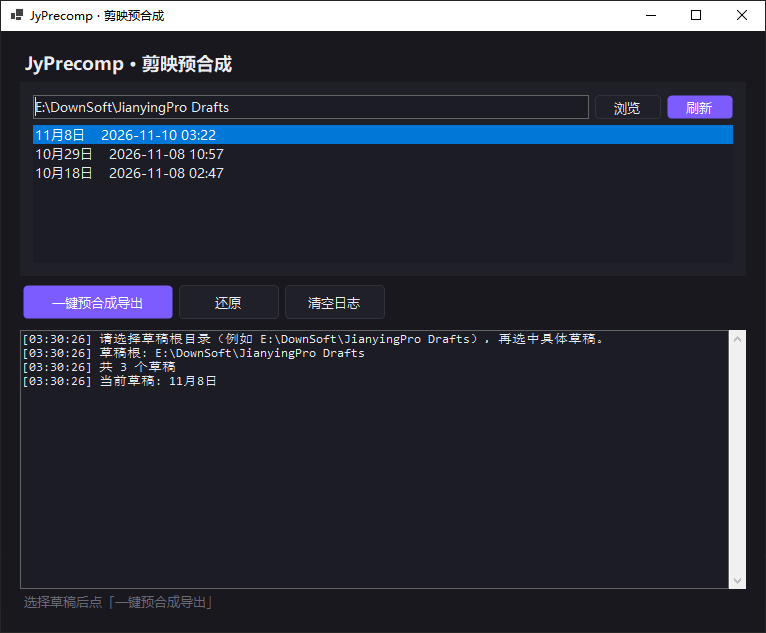

# JyPrecomp · 剪映预合成

一键：全选 → 复合 → 预合成 → 导入 → 导出面板；导完后 **Ctrl+Z × 5** 还原时间线。

## 用法

1. 剪映打开目标草稿  
2. 本工具选择草稿根目录（如 `E:\DownSoft\JianyingPro Drafts`）并选中草稿  
3. 点「一键预合成导出」  
4. 在剪映中导出  
5. 点「还原」

## 示例


## 编译

```bash
dotnet build JyPrecomp.sln -c Release
```

需要 .NET 8 Windows。
